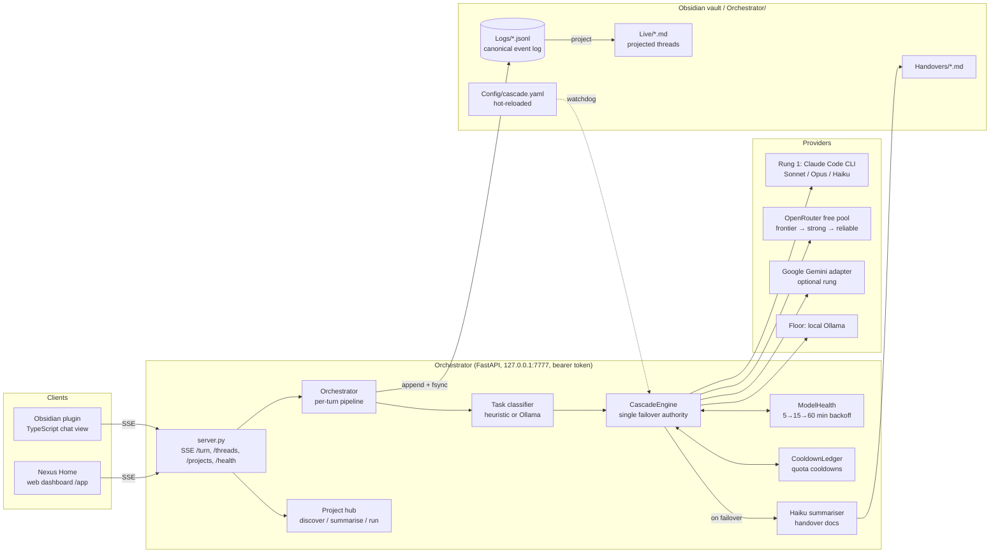

# Nexus

**A local AI orchestrator that fails over across Claude, free OpenRouter models and a local Ollama model, and keeps every conversation in an Obsidian vault as plain files.**

<!-- Screenshot / demo GIF goes here -->

> _Placeholder: add a screenshot or GIF of the Nexus Home dashboard or the Obsidian chat view at `docs/demo.gif`._

---

## What it does

Nexus is a single-user server that runs on your own machine (FastAPI on `127.0.0.1:7777`). You chat with it from an Obsidian sidebar plugin or a browser dashboard, and it decides which model answers:

- **Failover cascade.** Claude Sonnet (through the Claude Code CLI on a Pro subscription) is tried first. If it fails, Nexus moves to a pool of free OpenRouter models ranked by tier, then to a local Ollama model as a floor that needs no network. This happens mid-turn, without the user doing anything.
- **Continuity across models.** When it switches model, Nexus writes a handover document (summarised by Claude Haiku, or a template if Haiku is unreachable) and puts it into the next model's system prompt, so the conversation picks up where it left off.
- **Turn modes.** Each message is classified (conversational / coding / research / general) and routed in `light`, `hard` or `research` mode. Light chat skips the Claude rung to save Pro quota. Coding turns prefer coding-specialist models.
- **Vault as memory.** Every turn is appended to a per-thread JSONL event log inside the vault and projected into readable Markdown notes with YAML frontmatter. Trivial exchanges ("hi" / "ok") are filtered out before saving.
- **Project hub.** It scans a folder (default `~/Documents`) for code projects, summarises each one with Claude into a vault note, and can inject those summaries into chat ("what does project X do?"). From the dashboard it can also open a project in VS Code or Finder, or start and stop its run command.

## Why I built it

I pay for Claude Pro and wanted to use it as my main model without being stuck when the weekly quota runs out or the CLI fails. The existing Obsidian AI plugins I looked at are single-model chat or note retrieval. None of them keep one conversation going across providers, with failover you can see and the vault as the source of truth. Nexus treats free tiers (OpenRouter, Ollama) as a real operating mode, not a degraded one. The full design rationale is in [`obsidian-nexus-technical-plan.md`](obsidian-nexus-technical-plan.md).

---

## Architecture



**Request flow for one turn:**
1. `POST /turn` streams Server-Sent Events back to the client.
2. The orchestrator loads thread history from the JSONL log and builds the prompt (optionally with project summaries).
3. The cascade engine classifies the turn, resolves `auto` mode, and picks the first candidate that is healthy and not cooling down.
4. On an adapter error it classifies the failure, updates the health or cooldown ledgers, writes a handover doc, emits a `handover` event, and retries on the next candidate with the handover in the system prompt.
5. When streaming finishes, the turn is appended to JSONL (if it's worth saving) and the Markdown thread is rebuilt from the log.

### Repository layout

| Path | Contents |
|---|---|
| `nexus/orchestrator/` | Python backend: `adapters/`, `cascade/`, `heuristics/`, `projects/`, `tools/`, `vault/`, `webapp/` |
| `nexus/plugin/` | Obsidian plugin (TypeScript, esbuild) |
| `nexus/tests/` | pytest suite (unit, plus integration tests gated behind flags) |
| `nexus/docs/` | Per-phase acceptance reports with test output and live evidence |
| `nexus/examples/cascade.yaml` | Working cascade config to copy into your vault |
| `nexus-build/` | Per-phase task specs the project was built from |
| `OPEN_QUESTIONS.md` | Running log of decisions, incidents and deferred issues |

---

## Key engineering decisions and hard problems

**One failover authority.** Adapters only raise typed errors (`AdapterRateLimit`, `AdapterQuotaExhausted`, `AdapterModelUnavailable`, …). Only `CascadeEngine` decides whether to retry, cool down or fail over (`cascade/engine.py`). This keeps retry logic out of four different provider adapters.

**Telling "rate-limited" apart from "dead".** In an earlier phase every HTTP 4xx, including 404, was treated as a rate limit with a 30 s cooldown. Models that had been removed from OpenRouter showed up as "briefly rate-limited" indefinitely. The fix added a separate `AdapterModelUnavailable` error and narrowed the quota keywords. Failures now take one of three paths (documented in `docs/phase-2c-acceptance-report.md`):
- per-model 429 → short per-model cooldown
- account-wide daily quota → one shared `openrouter_shared` cooldown that skips every pool member at once
- dead model → exponential backoff in `ModelHealth` (5 → 15 → 60 min)

**Recovery probes without probe storms.** When a dead model's backoff expires, the engine runs one deep health check before routing real traffic to it. The probe result is cached for 60 s, and the cache is set *before* the `await`, so two turns arriving together don't both probe (`_select_with_recovery_probe`).

**JSONL is the source of truth; Markdown is derived.** Each event is written with `O_APPEND` plus `fsync` (`vault/event_log.py`). On read, a torn tail write (e.g. a process killed mid-append) is detected and the file is cut back to the last good line. If a valid line appears *after* a corrupt one, it logs loudly rather than trusting it. Markdown threads can always be rebuilt from the log.

**Using a Claude Pro subscription instead of the paid API.** Rung 1 runs `claude --print --output-format stream-json --verbose` as an async subprocess and parses its streamed JSON (`adapters/anthropic.py`). Opus is used only when a message contains `#opus` (the tag is stripped before sending) or an optional heuristic fires. Light-mode turns skip rung 1 entirely to save quota.

**Handover docs that survive a missing summariser.** If Haiku is unavailable during a failover, the engine falls back to a template handover (last user intent plus a link to the full history), so failover never blocks on the summariser.

**Hot-reloadable config that can't brick the server.** A `watchdog` thread watches `cascade.yaml` and schedules a reload on the server's event loop with `run_coroutine_threadsafe`. An invalid file is logged and the previous config is kept. The event loop is captured lazily because it doesn't exist yet when the engine is constructed.

**Conservative persistence filter.** A turn is dropped from the log only if *both* the user message and the reply are trivial (`heuristics/save_worthiness.py`). A real question with a one-word answer still saves.

**Local-only security model.** The server binds to `127.0.0.1`. A random 256-bit bearer token is generated on first run and stored with `0600` permissions. CORS allows only Obsidian origins and localhost. The project "open" action refuses paths outside the configured `scan_root`.

**Documented trade-offs.** `OPEN_QUESTIONS.md` records known limitations rather than hiding them. Examples: project process state is in-memory only and doesn't survive a restart; the dashboard templates the token into the HTML.

---

## Tech stack

- **Backend:** Python 3.11+, FastAPI, Uvicorn, Pydantic 2, httpx, tenacity, PyYAML, python-frontmatter, watchdog, uuid-utils (UUIDv7)
- **Providers:** Claude Code CLI (subprocess), Anthropic SDK (optional web-tools path), OpenRouter (httpx streaming), Google Gen AI SDK, Ollama
- **Tools:** DDGS web search, web fetch
- **Frontend:** Obsidian plugin in TypeScript (esbuild); vanilla JS/CSS dashboard served by FastAPI
- **Quality:** pytest + pytest-asyncio + respx, ruff, mypy (`strict = true`)

---

## Setup and running

### Prerequisites
- macOS or Linux, Python 3.11+, Node.js (only to build the Obsidian plugin)
- An Obsidian vault (an empty folder works)
- Optional, per rung:
  - [Claude Code](https://docs.anthropic.com/en/docs/claude-code) installed and logged in, for rung 1
  - an OpenRouter API key, for the free pool
  - [Ollama](https://ollama.com) with a model pulled (`ollama pull gemma4`), for the floor

### 1. Install the orchestrator
```bash
cd nexus
python3 -m venv .venv
source .venv/bin/activate
pip install -e ".[dev]"
```

### 2. Configure
```bash
# API keys — copy the template, fill it in, and export into your shell
cp ../.env.example ../.env
set -a; source ../.env; set +a     # the server reads keys from the process environment

# Cascade config lives inside the vault
VAULT=~/path/to/your-vault
mkdir -p "$VAULT/Orchestrator/Config"
cp examples/cascade.yaml "$VAULT/Orchestrator/Config/cascade.yaml"
```

### 3. Run
```bash
python -m orchestrator --vault "$VAULT"          # serves on http://127.0.0.1:7777
```
- Dashboard: open <http://127.0.0.1:7777/app>
- Health and pool status: `curl http://127.0.0.1:7777/health`
- The bearer token is created at `$VAULT/Orchestrator/Config/auth.token` on first run.

### 4. (Optional) Obsidian plugin
```bash
cd plugin
npm install
npm run build
mkdir -p "$VAULT/.obsidian/plugins/obsidian-nexus"
cp main.js manifest.json styles.css "$VAULT/.obsidian/plugins/obsidian-nexus/"
```
Enable **Obsidian Nexus** under Settings → Community plugins. The plugin reads the auth token from the vault automatically.

### Tests
```bash
cd nexus
pytest tests/ --ignore=tests/integration -q        # unit tests, no network needed
pytest tests/integration/ --real-claude -v         # live tests: need Claude Code login
pytest tests/integration/ --real-providers -v      # live tests: need provider keys
```

---

## Numbers

From the test suite and the per-phase acceptance reports in `nexus/docs/`. These were measured on one developer machine with small samples, not under benchmark conditions.

| Metric | Value | Source |
|---|---|---|
| Unit tests | 771 passing (integration tests excluded) | `pytest --ignore=tests/integration`, current tree |
| Rung-1 turn latency, P50 / P95 | ~3.1 s / ~12 s, Claude Code cold start included, 5 turns [verify] | `docs/phase-1-acceptance-report.md` |
| Full failover, Claude → OpenRouter model, to first token | ~15–22 s [verify] | `docs/phase-2a-acceptance-report.md` |
| Free-pool probe response times | 3.7 s (gemma-4-31b) to 14.6 s (nemotron-3-ultra) | `docs/phase-3w-acceptance-report.md` |

---

## Status

This is a personal project, built in phases (1 → 2a/2b/2c → 3A/3W/3B). Each phase has a spec in `nexus-build/` and an acceptance report in `nexus/docs/`. Free OpenRouter model slugs change often, so the pool in `examples/cascade.yaml` may need refreshing.

## License

[MIT](LICENSE)
